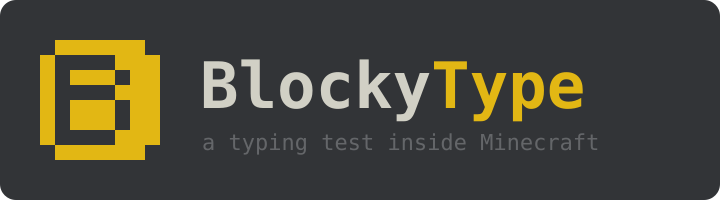

  

<h1 align="center">BlockyType - a typing test inside Minecraft</h1>

---

Welcome to BlockyType. This is a typing game inspired by [Monkeytype](https://monkeytype.com) that allows you to test
and improve your typing skills, straight from Minecraft. It contains almost all features from Monkeytype uses its
minimalistic style.

This server is built with [Minestom](https://minestom.net) for increased performance and minimal overhead.

BlockyType is completely free and open-source and is designed to be self-hostable, so that anyone can host their own instance easily.

## Features

### Invisible typing UI
The vanilla command-block edit screen is fully hidden by the server's own resource pack; the whole game is drawn through one HUD boss bar instead.
### No-cursor keyboard menus 
Settings and admin menus are navigated entirely with the keyboard, no mouse cursor at all.
### Live result graph & heatmap 
After each test, a wpm/raw graph with error markers and a per-word speed heatmap, scrubbable second by second.
### 22 switchable fonts
JetBrains Mono plus 21 more monospace fonts (downloaded on first start), swappable at runtime with a live pack reload. Add your own in `fonts/custom/`.
### Monkeytype-faithful metrics & modes
WPM/raw/accuracy/consistency formulas and time/words/quote/zen modes ported directly from Monkeytype.
### Player profiles & admin tools
In-game profile pages (face, level, personal bests) plus in-game admin network settings editing.

## Installation / Self Hosting

This is the recommended way to play. You can either host this on your PC directly or on a remote server.

### Stable Release (recommended)
1. Go to the **Releases** page;
2. On the latest release, scroll down and find the JAR file, then click to download it.
3. Place the JAR file in an empty folder and start the server;
4. Start the server. If you have hosted the server on your PC, then the IP should be `localhost` or `127.0.0.1`.
    Otherwise, it will be the IP of the remote server. **The default port, if unchanged, is always 25565.**

### Development Release
> [!IMPORTANT]
> To download development releases, you must be logged in with a GitHub account.
> Development releases aren't guaranteed to be stable, so use them if you only want to test experimental features.
1. Go to the **Actions** page.
2. Select a commit, then scroll down to **Artifacts** and download the JAR file.
3. Follow steps 3-4 above.

## Credits and license

BlockyType is licensed under the GNU General Public License v3.0, the same license as Monkeytype.

- [Monkeytype](https://github.com/monkeytypegame/monkeytype): word lists, metric definitions and sounds. The audio files come from its repository, and their license is not stated there.
- [Minestom](https://github.com/Minestom/Minestom): the server framework.
- Fonts: each font keeps its own license. JetBrains Mono ships in the jar, the others are downloaded together with their license into `fonts/builtin/`.
